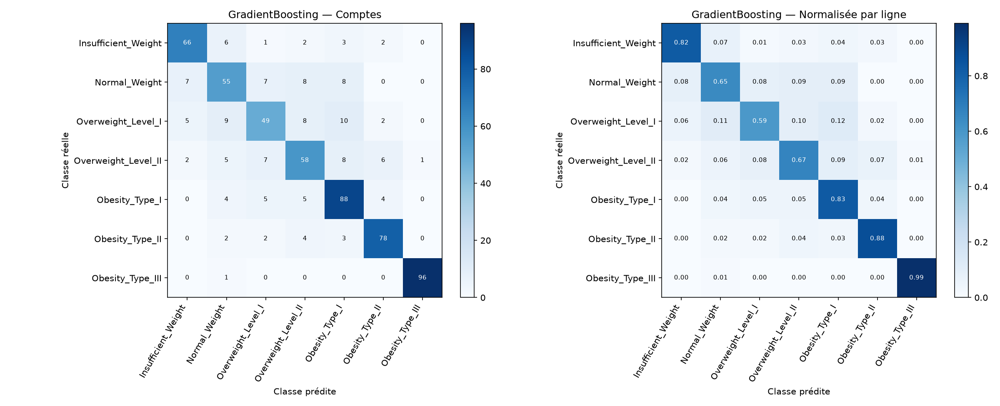
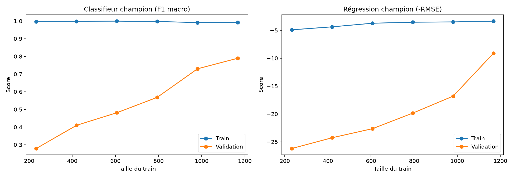
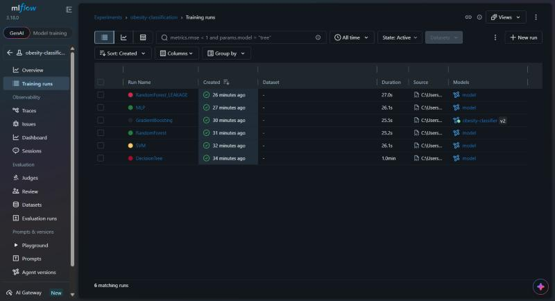
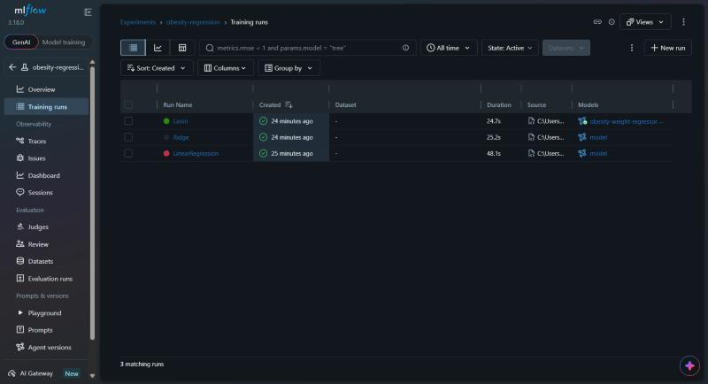
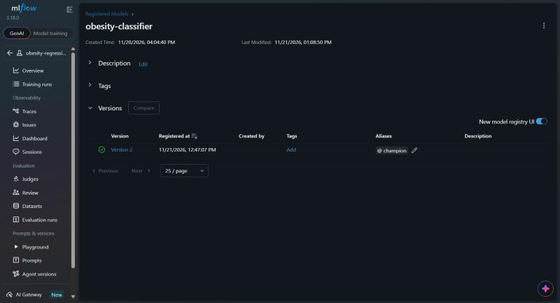

<div align="center">

# Obesity Levels
### Prédire le niveau d'obésité et le poids à partir des habitudes alimentaires et du mode de vie

<p>Classer une personne dans l'un des sept niveaux d'obésité, et estimer son poids, à partir de ses habitudes alimentaires et de sa condition physique. Le projet compare plusieurs classifieurs, vérifie l'absence de fuite de données et livre le modèle retenu avec le suivi MLflow, une API FastAPI, une interface Streamlit, Docker et une CI.</p>

<p>
  <a href="reports/rapport_obesity_levels.pdf"></a>
  <a href="README.md"></a>
  <a href="https://github.com/salmahanabal/obesity-levels/actions/workflows/ci.yml"></a>
</p>

<p>
  <a href="#résultats"></a>
  <a href="#résultats"></a>
  <a href="#résultats"></a>
  <a href="https://archive.ics.uci.edu/dataset/544"></a>
</p>

<p>
  <a href="https://scikit-learn.org/stable/modules/tree.html"></a>
  <a href="https://scikit-learn.org/stable/modules/svm.html"></a>
  <a href="https://scikit-learn.org/stable/modules/ensemble.html#forest"></a>
  <a href="https://scikit-learn.org/stable/modules/ensemble.html#histogram-based-gradient-boosting"></a>
  <a href="https://scikit-learn.org/stable/modules/neural_networks_supervised.html"></a>
</p>

<p>
  <a href="https://www.python.org/"></a>
  <a href="https://scikit-learn.org/"></a>
  <a href="https://pandas.pydata.org/"></a>
  <a href="https://mlflow.org/"></a>
  <a href="https://fastapi.tiangolo.com/"></a>
  <a href="https://streamlit.io/"></a>
  <a href="https://www.docker.com/"></a>
  <a href="https://jupyter.org/"></a>
</p>

</div>

---

## Sommaire

- [Présentation](#présentation)
- [Points forts](#points-forts)
- [Données](#données)
- [Trois pipelines, un seul découpage](#trois-pipelines-un-seul-découpage)
- [Résultats](#résultats)
- [Interface web](#interface-web)
- [MLflow](#mlflow)
- [API](#api)
- [Structure du projet](#structure-du-projet)
- [Démarrage](#démarrage)
- [Qualité](#qualité)
- [Limites](#limites)
- [Pistes d'amélioration](#pistes-damélioration)
- [Technologies](#technologies)
- [Auteure](#auteure)

---

## Présentation

Ce projet suit tout le flux **exploration, préprocessing, modélisation, évaluation, analyse critique** sur le jeu de données UCI *Estimation of Obesity Levels Based on Eating Habits and Physical Condition*, puis ajoute une couche MLOps légère.

Trois questions sont traitées :

1. Peut-on prédire le **niveau d'obésité** (7 classes) à partir des seules habitudes, sans le poids ni la taille ?
2. Peut-on estimer le **poids** par une régression linéaire ?
3. Les deux réponses sont-elles **cohérentes** : l'IMC calculé à partir du poids prédit donne-t-il la même classe que le classifieur ?

Le rapport complet (en français, 6 pages) est disponible [ici](reports/rapport_obesity_levels.pdf).

## Points forts

- **Aucune fuite de données.** La classe est définie à partir de l'IMC (poids / taille²) : donner le poids ou la taille au classifieur serait tricher. Ils sont exclus, et un run de référence séparé qui les inclut montre à quel point la fuite gonfle le score (accuracy 0,95 au lieu de 0,78).
- **Un seul découpage, ajusté une fois.** Un découpage stratifié 70/30 (graine 42) après suppression de 24 doublons. Le préprocessing est ajusté sur le train uniquement.
- **Choix du modèle honnête.** Cinq modèles sont optimisés par `GridSearchCV` (F1 macro, 5 plis). Le champion est choisi sur la validation croisée, jamais sur le test.
- **Analyse critique.** Surapprentissage, analyse des erreurs, données synthétiques, biais de genre et facteurs clés sont mesurés et discutés, pas seulement rapportés.
- **MLOps de base.** Suivi MLflow et registre, API FastAPI à validation stricte, interface de test Streamlit, Docker, tests et CI.

## Données

[Dataset UCI 544](https://archive.ics.uci.edu/dataset/544) : 2 111 personnes du Mexique, du Pérou et de Colombie, 17 colonnes (âge, genre, taille, poids, habitudes alimentaires, activité physique, transport et niveau d'obésité).

| Élément | Valeur |
| --- | --- |
| Lignes après suppression des doublons | 2 087 |
| Lignes d'entraînement / de test | 1 460 / 627 |
| Cible | `NObeyesdad`, 7 classes de Insufficient Weight à Obesity Type III |
| Lignes synthétiques | environ 77 % (générées par SMOTE) |

Trois propriétés de ce jeu de données structurent tout le projet :

- **La classe vient de l'IMC.** C'est pourquoi le poids et la taille sont retirés du classifieur.
- **Environ 77 % des lignes sont synthétiques.** Les scores sont optimistes : SMOTE crée des quasi-copies qui se retrouvent à la fois dans le train et dans le test.
- **Le genre est presque un raccourci pour deux classes.** Obesity Type II compte 295 hommes et 2 femmes, Obesity Type III 323 femmes et 1 homme.

## Trois pipelines, un seul découpage

| Pipeline | Tâche | Cible | Variables |
| --- | --- | --- | --- |
| A | Classification | `NObeyesdad` | tout sauf `Weight` et `Height` |
| B | Régression linéaire | `Weight` | tout sauf la classe (avec `Height`) |
| C | Cohérence | classe dérivée | IMC du poids prédit, comparé à A |

Un quatrième run, tagué `leakage_reference=true` dans MLflow, ajoute `Weight` et `Height` à A. Il ne sert qu'au contraste et n'est jamais retenu.

## Résultats

Tous les chiffres sont mesurés sur les 627 lignes de test. Le champion est le modèle au meilleur score de validation croisée.

### Classification (pipeline A)

| Modèle | F1 macro (CV) | Accuracy | F1 macro | Accuracy ±1 classe |
| --- | --- | --- | --- | --- |
| Gradient Boosting (champion) | **0,790** | 0,781 | 0,775 | 0,884 |
| Random Forest | 0,789 | **0,785** | **0,776** | 0,884 |
| SVM | 0,730 | 0,753 | 0,743 | 0,880 |
| MLP | 0,730 | 0,732 | 0,726 | 0,872 |
| Arbre de décision | 0,703 | 0,715 | 0,710 | 0,864 |
| *Random Forest avec fuite (référence)* | *0,937* | *0,947* | *0,946* | *0,990* |

Gradient Boosting et Random Forest sont à égalité : l'écart en validation croisée (0,001) est très inférieur au bruit, et Gradient Boosting n'est champion que parce que la règle est « meilleur en validation croisée ». Le score reste autour de 0,78 quel que soit l'algorithme : la limite vient des données (les habitudes seules n'expliquent pas entièrement l'IMC), pas du modèle. La plupart des erreurs tombent entre classes voisines, surtout Normal Weight et Overweight Level I, alors qu'Obesity Type III est presque parfaitement reconnue (rappel 0,99).

Matrice de confusion du Gradient Boosting :

<p align="center"></p>

**Stratégie du SVM.** Avec sept classes, un SVM peut être étendu en One-vs-Rest ou en One-vs-One. Le F1 macro en validation croisée vaut 0,730 (`SVC` natif), 0,736 (One-vs-Rest) et 0,730 (One-vs-One) : les écarts sont inférieurs à la variabilité, le choix est sans effet ici.

### Régression (pipeline B)

Linear, Ridge et Lasso sont quasi identiques : RMSE d'environ 18 kg et R² d'environ 0,52 sur le test. La régularisation n'apporte rien car les variables sont peu colinéaires (VIF maximal 7,0). Les résidus sont nettement hétéroscédastiques (Breusch-Pagan p ≈ 7·10⁻³⁶). Une cible en log(poids) aide légèrement (RMSE 17,7 kg, R² 0,54).

### Cohérence (pipeline C)

Prédire le poids puis en déduire la classe donne une accuracy de **0,23** (0,71 à une classe près), contre 0,78 pour la classification directe. Une erreur d'environ 18 kg déplace l'IMC de plusieurs points, souvent d'une classe entière. Les habitudes renseignent mieux sur la *classe* que sur le *poids exact*.

### Analyse critique

| Question | Constat |
| --- | --- |
| Surapprentissage | Les arbres atteignent 0,998 de F1 macro en apprentissage contre 0,71 à 0,78 en test. La courbe d'apprentissage monte encore : plus de données aideraient. |
| Lignes synthétiques | Accuracy 0,86 sur les lignes jugées synthétiques contre 0,56 sur les lignes jugées collectées (heuristique). Les scores globaux sont optimistes. |
| Biais de genre | F1 macro de 0,77 pour les femmes et 0,62 pour les hommes. Le genre est la deuxième variable par permutation (après l'âge). |
| Facteurs clés | L'âge et le genre dominent par permutation. La régression place l'antécédent familial de surpoids en premier (environ 20 kg). |
| Fuite | Avec poids et taille : accuracy 0,95. Sans : 0,78. |

<p align="center"></p>

## Interface web

Une application Streamlit pour essayer les modèles sans écrire de code (`make ui`). Elle a deux onglets :

- **Données.** Téléchargement des données nettoyées, pré-traitées, d'entraînement et de test, ou téléversement de votre propre CSV. Les résultats s'affichent en figures expliquées pour des non-spécialistes (répartition des classes, confiance, distribution du poids, matrice de confusion si la vraie classe est présente) et ne sont pas téléchargeables. Si le fichier contient la colonne `Weight` d'origine, le poids estimé est comparé au vrai poids (erreur moyenne, part à ±10 kg, nuage de points estimé contre réel et histogramme des erreurs). Le vrai poids n'est jamais donné aux modèles : il sert uniquement à la comparaison.
- **Saisie manuelle.** Un guide explique chaque variable, puis un formulaire prédit le niveau d'obésité, le poids et l'IMC d'une personne, avec la probabilité de chaque classe. Vous pouvez saisir en option le vrai poids de la personne pour voir l'écart avec l'estimation.

Elle nécessite d'avoir lancé `make all` au préalable.

## MLflow

Deux expériences (`obesity-classification`, `obesity-regression`), un run par modèle avec paramètres, métriques de validation croisée et de test, matrice de confusion, rapport par classe et modèle signé. Chaque run porte les tags `git_commit`, `dataset_hash` et `split_seed`. Les deux champions sont enregistrés avec l'alias `champion`.

<p align="center"></p>
<p align="center"></p>
<p align="center"></p>

## API

`make serve` lance un service FastAPI sur le port 8000, avec une validation Pydantic stricte (bornes et valeurs autorisées, erreurs 422 explicites).

```bash
curl http://localhost:8000/health

curl -X POST http://localhost:8000/predict/class -H "Content-Type: application/json" \
  -d '{"Gender":"Female","Age":25,"family_history_with_overweight":"yes","FAVC":"yes","FCVC":2,"NCP":3,"CAEC":"Sometimes","SMOKE":"no","CH2O":2,"SCC":"no","FAF":1,"TUE":1,"CALC":"no","MTRANS":"Public_Transportation"}'

curl -X POST http://localhost:8000/predict/weight -H "Content-Type: application/json" \
  -d '{"Gender":"Female","Age":25,"Height":1.70,"family_history_with_overweight":"yes","FAVC":"yes","FCVC":2,"NCP":3,"CAEC":"Sometimes","SMOKE":"no","CH2O":2,"SCC":"no","FAF":1,"TUE":1,"CALC":"no","MTRANS":"Public_Transportation"}'
```

`/predict/class` prend uniquement les habitudes (ni taille, ni poids). `/predict/weight` prend aussi la taille et renvoie le poids, l'IMC et la classe dérivée. Avec `MODEL_SOURCE=registry`, les modèles sont chargés depuis le registre MLflow au lieu des fichiers joblib.

## Structure du projet

```
.
├── config.yaml                  # graine, colonnes, seuils d'IMC, noms MLflow
├── src/obesity/
│   ├── data.py, eda.py          # chargement, nettoyage, exploration
│   ├── preprocessing.py         # découpage, ColumnTransformer
│   ├── train_classification.py  # pipeline A (GridSearchCV + MLflow)
│   ├── train_regression.py      # pipeline B (Linear / Ridge / Lasso, OLS, VIF)
│   ├── consistency.py           # pipeline C
│   ├── evaluate.py, analysis.py # tableaux comparatifs, analyse critique
│   ├── registry.py              # registre MLflow + export joblib
│   ├── api/                     # service FastAPI
│   └── ui/                      # textes et figures de l'application Streamlit
├── app/streamlit_app.py         # interface de test
├── notebooks/                   # 01 exploration, 02 préprocessing, 03 modélisation, 04 analyse critique
├── reports/                     # rapport (PDF), figures, tableaux
├── docker/                      # Dockerfile et compose
├── tests/                       # pytest
├── docs/                        # décisions de conception, captures MLflow
└── .github/workflows/           # ci.yml, full-pipeline.yml
```

## Démarrage

Python 3.11 est nécessaire.

```bash
git clone https://github.com/salmahanabal/obesity-levels.git
cd obesity-levels

python -m venv .venv
# Windows (PowerShell) :  .venv\Scripts\Activate.ps1
# macOS / Linux :         source .venv/bin/activate

make setup      # installe le paquet et les outils de développement
make all        # données, entraînement, évaluation, export (environ 15 minutes)
```

Sans réseau, déposez d'abord `ObesityDataSet_raw_and_data_sinthetic.csv` dans `data/raw/`.

| Commande | Rôle |
| --- | --- |
| `make data` | charge et nettoie les données |
| `make eda` | figures et tableaux d'exploration |
| `make train-clf` / `make train-reg` | `GridSearchCV` et runs MLflow |
| `make consistency` | pipeline C |
| `make evaluate` | tableaux comparatifs |
| `make export` | registre MLflow (alias `champion`) et `models/*.joblib` |
| `make serve` | API sur le port 8000 |
| `make ui` | interface Streamlit (`pip install -e ".[ui]"`) |
| `make mlflow-ui` | interface MLflow sur le port 5000 |
| `make report` | régénère le rapport PDF (`pip install -e ".[report]"`) |
| `make test` / `make lint` | pytest / ruff |
| `make docker-build` | construit l'image Docker (lancer `make all` avant) |

Avec Docker :

```bash
make all
docker compose -f docker/docker-compose.yml up --build
```

## Qualité

- 33 tests `pytest` : découpage, préprocessing, absence de fuite, seuils d'IMC, pipelines, API, textes de l'interface.
- `ruff` pour le lint.
- GitHub Actions : `ci.yml` lance lint et tests à chaque push. `full-pipeline.yml` rejoue tout sur une machine propre (`make all`, les quatre notebooks, la construction de l'image Docker et des appels à l'API dans le conteneur).

## Limites

- Environ 77 % des données sont synthétiques : les scores sont optimistes, y compris ceux de la validation croisée.
- Un seul découpage est utilisé. Le score de test a donc une certaine variance, et l'écart entre les deux meilleurs modèles n'est pas significatif.
- La classe est dérivée du poids et de la taille, que le classifieur ne voit pas : un plafond d'environ 0,78 de F1 macro est attendu.
- Le modèle utilise le genre comme raccourci pour deux classes, et son équité entre hommes et femmes n'est pas garantie.
- Les données viennent de trois pays et décrivent des habitudes déclarées. Les modèles sont un exercice pédagogique, pas un outil médical.

## Pistes d'amélioration

- Traiter l'IMC comme une cible continue ou ordinale plutôt que sept classes indépendantes.
- Retirer les lignes synthétiques du test, ou évaluer uniquement sur les lignes collectées.
- Validation croisée répétée pour dire si les meilleurs modèles diffèrent vraiment.
- Entraînement tenant compte de l'équité et calibration par genre.
- DVC pour versionner les données et Evidently pour surveiller la dérive.

## Technologies

Python, pandas, NumPy, scikit-learn, statsmodels, matplotlib, MLflow, FastAPI, Pydantic, Streamlit, Docker, GitHub Actions, pytest, ruff, Jupyter.

## Auteure

<table>
  <tr>
    <td align="center"><a href="https://github.com/salmahanabal"><b>Salma Hanabal</b></a><br><sub>@salmahanabal</sub></td>
  </tr>
</table>
