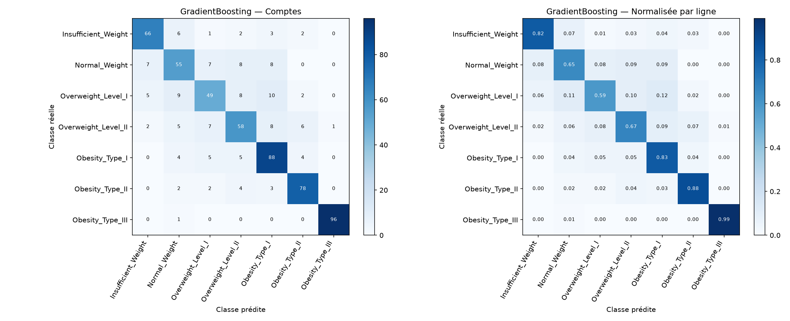
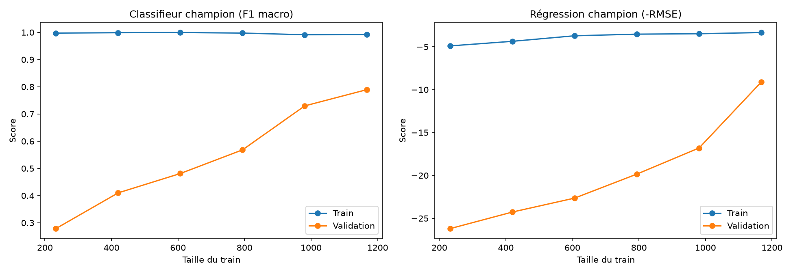

<div align="center">

# Obesity Levels
### Predicting obesity level and weight from eating habits and lifestyle

<p>Classify a person into one of seven obesity levels, and estimate their weight, from eating habits and physical condition. The project compares several classifiers, checks the results for data leakage, and ships the chosen model with MLflow tracking, a FastAPI service, a Streamlit interface, Docker and CI.</p>

<p>
  <a href="reports/rapport_obesity_levels.pdf"></a>
  <a href="README.fr.md"></a>
  <a href="https://github.com/salmahanabal/obesity-levels/actions/workflows/ci.yml"></a>
</p>

<p>
  <a href="#results"></a>
  <a href="#results"></a>
  <a href="#results"></a>
  <a href="https://archive.ics.uci.edu/dataset/544"></a>
</p>

<p>
  
  
  
  
  
</p>

<p>
  
  
  
  
  
  
  
  
</p>

</div>

---

## Table of contents

- [Overview](#overview)
- [Highlights](#highlights)
- [Dataset](#dataset)
- [Three pipelines, one split](#three-pipelines-one-split)
- [Results](#results)
- [Web interface](#web-interface)
- [MLflow](#mlflow)
- [API](#api)
- [Project structure](#project-structure)
- [Getting started](#getting-started)
- [Quality](#quality)
- [Limitations](#limitations)
- [Ideas for improvement](#ideas-for-improvement)
- [Tech stack](#tech-stack)
- [Author](#author)

---

## Overview

This project follows the whole workflow **exploration, preprocessing, modeling, evaluation, critical analysis** on the UCI dataset *Estimation of Obesity Levels Based on Eating Habits and Physical Condition*, then adds a light MLOps layer around it.

Three questions are answered:

1. Can the **obesity level** (7 classes) be predicted from habits alone, without weight and height?
2. Can the **weight** be estimated with a linear regression?
3. Are the two answers **consistent**: does the BMI computed from the predicted weight give the same class as the classifier?

The full report (in French, 6 pages) is available [here](reports/rapport_obesity_levels.pdf).

## Highlights

- **No data leakage.** The class is defined from the BMI (weight / height²), so giving weight or height to the classifier would be cheating. They are excluded, and a separate reference run that includes them shows how much the leakage inflates the score (accuracy 0.95 instead of 0.78).
- **One split, fitted once.** A single stratified 70/30 split (seed 42) after removing 24 duplicates. The preprocessing is fitted on the training set only.
- **Honest model choice.** Five models are tuned with `GridSearchCV` (macro F1, 5 folds). The champion is chosen on cross-validation, never on the test set.
- **Critical analysis.** Overfitting, error analysis, synthetic data, gender bias and key factors are measured and discussed, not just reported.
- **MLOps basics.** MLflow tracking and model registry, a FastAPI service with strict validation, a Streamlit test interface, Docker, tests and CI.

## Dataset

[UCI dataset 544](https://archive.ics.uci.edu/dataset/544): 2,111 people from Mexico, Peru and Colombia, 17 columns (age, gender, height, weight, eating habits, physical activity, transport, and the obesity level).

| Item | Value |
| --- | --- |
| Rows after removing duplicates | 2,087 |
| Training rows / test rows | 1,460 / 627 |
| Target | `NObeyesdad`, 7 classes from Insufficient Weight to Obesity Type III |
| Synthetic rows | about 77 % (generated with SMOTE) |

Three properties of this dataset shape the whole project:

- **The class comes from the BMI.** This is why weight and height are removed from the classifier.
- **About 77 % of the rows are synthetic.** Scores are optimistic: SMOTE creates near-copies that end up in both the training and the test sets.
- **Gender is almost a shortcut for two classes.** Obesity Type II is 295 men and 2 women, Obesity Type III is 323 women and 1 man.

## Three pipelines, one split

| Pipeline | Task | Target | Variables |
| --- | --- | --- | --- |
| A | Classification | `NObeyesdad` | everything except `Weight` and `Height` |
| B | Linear regression | `Weight` | everything except the class (with `Height`) |
| C | Consistency | derived class | BMI from the predicted weight, compared with A |

A fourth run, tagged `leakage_reference=true` in MLflow, adds `Weight` and `Height` to A. It is only used for contrast and is never selected.

## Results

All figures are measured on the 627 test rows. The champion is the model with the best cross-validation score.

### Classification (pipeline A)

| Model | F1 macro (CV) | Accuracy | F1 macro | Accuracy ±1 class |
| --- | --- | --- | --- | --- |
| Gradient Boosting (champion) | **0.790** | 0.781 | 0.775 | 0.884 |
| Random Forest | 0.789 | **0.785** | **0.776** | 0.884 |
| SVM | 0.730 | 0.753 | 0.743 | 0.880 |
| MLP | 0.730 | 0.732 | 0.726 | 0.872 |
| Decision Tree | 0.703 | 0.715 | 0.710 | 0.864 |
| *Random Forest with leakage (reference)* | *0.937* | *0.947* | *0.946* | *0.990* |

Gradient Boosting and Random Forest are tied: the gap in cross-validation (0.001) is well inside the noise, and Gradient Boosting is the champion only because the rule is "best in cross-validation". The score stays around 0.78 whatever the algorithm: the limit comes from the data (habits alone do not fully explain the BMI), not from the model. Most errors fall between neighbouring classes, mainly Normal Weight and Overweight Level I, while Obesity Type III is almost perfectly recognised (recall 0.99).

Gradient Boosting confusion matrix:

<p align="center"></p>

**SVM strategy.** With seven classes, a SVM can be extended One-vs-Rest or One-vs-One. Cross-validated macro F1 is 0.730 (native `SVC`), 0.736 (One-vs-Rest) and 0.730 (One-vs-One): the differences are smaller than the variability, so the choice does not matter here.

### Regression (pipeline B)

Linear, Ridge and Lasso are almost identical: RMSE of about 18 kg and R² of about 0.52 on the test set. Regularisation brings nothing because the variables are barely collinear (maximum VIF 7.0). The residuals are clearly heteroscedastic (Breusch-Pagan p ≈ 7·10⁻³⁶). A log(weight) target helps slightly (RMSE 17.7 kg, R² 0.54).

### Consistency (pipeline C)

Predicting the weight and then deriving the class gives an accuracy of **0.23** (0.71 within one class), against 0.78 for the direct classification. An error of about 18 kg moves the BMI by several points, often by a whole class. Habits tell more about the *class* than about the *exact weight*.

### Critical analysis

| Question | Finding |
| --- | --- |
| Overfitting | Trees reach 0.998 macro F1 on training against 0.71 to 0.78 on test. The learning curve keeps rising: more data would help. |
| Synthetic rows | Accuracy 0.86 on rows judged synthetic against 0.56 on rows judged collected (heuristic). Global scores are optimistic. |
| Gender bias | Macro F1 of 0.77 for women and 0.62 for men. Gender is the second most important variable by permutation (after age). |
| Key factors | Age and gender dominate by permutation. The regression puts family history of overweight first (about 20 kg). |
| Leakage | With weight and height: accuracy 0.95. Without: 0.78. |

<p align="center"></p>

## Web interface

A Streamlit app to try the models without writing code (`make ui`). It has two tabs:

- **Data.** Download the cleaned, preprocessed, training and test data, or upload your own CSV. The results are shown as figures explained for non-specialists (class distribution, confidence, weight distribution, confusion matrix when the true class is present) and cannot be downloaded. If the file contains the original `Weight` column, the estimated weight is compared with the real one (mean error, share within ±10 kg, estimated-versus-real scatter plot and error histogram). The real weight is never given to the models; it is only used for the comparison.
- **Manual input.** A guide explains every variable, then a form predicts the obesity level, the weight and the BMI of one person, with the probability of each class. You can optionally enter the person's real weight to see the gap with the estimate.

It needs `make all` to have been run first.

## MLflow

Two experiments (`obesity-classification`, `obesity-regression`), one run per model with parameters, cross-validation and test metrics, confusion matrix, per-class report and a signed model. Every run carries the tags `git_commit`, `dataset_hash` and `split_seed`. The two champions are registered with the alias `champion`.

<p align="center"></p>
<p align="center"></p>
<p align="center"></p>

## API

`make serve` starts a FastAPI service on port 8000 with strict Pydantic validation (allowed ranges and values, explicit 422 errors).

```bash
curl http://localhost:8000/health

curl -X POST http://localhost:8000/predict/class -H "Content-Type: application/json" \
  -d '{"Gender":"Female","Age":25,"family_history_with_overweight":"yes","FAVC":"yes","FCVC":2,"NCP":3,"CAEC":"Sometimes","SMOKE":"no","CH2O":2,"SCC":"no","FAF":1,"TUE":1,"CALC":"no","MTRANS":"Public_Transportation"}'

curl -X POST http://localhost:8000/predict/weight -H "Content-Type: application/json" \
  -d '{"Gender":"Female","Age":25,"Height":1.70,"family_history_with_overweight":"yes","FAVC":"yes","FCVC":2,"NCP":3,"CAEC":"Sometimes","SMOKE":"no","CH2O":2,"SCC":"no","FAF":1,"TUE":1,"CALC":"no","MTRANS":"Public_Transportation"}'
```

`/predict/class` takes habits only (no height, no weight). `/predict/weight` also takes the height and returns the weight, the BMI and the derived class. With `MODEL_SOURCE=registry` the models are loaded from the MLflow registry instead of the joblib files.

## Project structure

```
.
├── config.yaml                  # seed, columns, BMI thresholds, MLflow names
├── src/obesity/
│   ├── data.py, eda.py          # loading, cleaning, exploration
│   ├── preprocessing.py         # split, ColumnTransformer
│   ├── train_classification.py  # pipeline A (GridSearchCV + MLflow)
│   ├── train_regression.py      # pipeline B (Linear / Ridge / Lasso, OLS, VIF)
│   ├── consistency.py           # pipeline C
│   ├── evaluate.py, analysis.py # comparison tables, critical analysis
│   ├── registry.py              # MLflow registry + joblib export
│   ├── api/                     # FastAPI service
│   └── ui/                      # texts and figures of the Streamlit app
├── app/streamlit_app.py         # test interface
├── notebooks/                   # 01 exploration, 02 preprocessing, 03 modeling, 04 critical analysis
├── reports/                     # report (PDF), figures, tables
├── docker/                      # Dockerfile and compose file
├── tests/                       # pytest
├── docs/                        # design decisions, MLflow screenshots
└── .github/workflows/           # ci.yml, full-pipeline.yml
```

## Getting started

You need Python 3.11.

```bash
git clone https://github.com/salmahanabal/obesity-levels.git
cd obesity-levels

python -m venv .venv
# Windows (PowerShell):  .venv\Scripts\Activate.ps1
# macOS / Linux:         source .venv/bin/activate

make setup      # installs the package and the dev tools
make all        # data, training, evaluation, export (about 15 minutes)
```

Without network access, put `ObesityDataSet_raw_and_data_sinthetic.csv` in `data/raw/` first.

| Command | Purpose |
| --- | --- |
| `make data` | load and clean the data |
| `make eda` | exploration figures and tables |
| `make train-clf` / `make train-reg` | `GridSearchCV` and MLflow runs |
| `make consistency` | pipeline C |
| `make evaluate` | comparison tables |
| `make export` | MLflow registry (alias `champion`) and `models/*.joblib` |
| `make serve` | API on port 8000 |
| `make ui` | Streamlit interface (`pip install -e ".[ui]"`) |
| `make mlflow-ui` | MLflow interface on port 5000 |
| `make report` | rebuild the PDF report (`pip install -e ".[report]"`) |
| `make test` / `make lint` | pytest / ruff |
| `make docker-build` | build the Docker image (run `make all` first) |

With Docker:

```bash
make all
docker compose -f docker/docker-compose.yml up --build
```

## Quality

- 33 `pytest` tests: split, preprocessing, absence of leakage, BMI thresholds, pipelines, API, interface texts.
- `ruff` for linting.
- GitHub Actions: `ci.yml` runs lint and tests on every push. `full-pipeline.yml` replays everything on a clean machine (`make all`, the four notebooks, the Docker build and API calls inside the container).

## Limitations

- About 77 % of the data is synthetic, so the scores are optimistic, including the cross-validation scores.
- A single split is used. The test score therefore has some variance, and the gap between the two best models is not significant.
- The class is derived from weight and height, which the classifier cannot see. A ceiling of about 0.78 macro F1 is expected.
- The model uses gender as a shortcut for two classes, and its fairness between men and women is not guaranteed.
- The data come from three countries and describe self-reported habits. The models are a teaching exercise, not a medical tool.

## Ideas for improvement

- Treat the BMI as a continuous or ordinal target instead of seven independent classes.
- Remove synthetic rows from the test set, or evaluate on collected rows only.
- Repeated cross-validation to say whether the top models really differ.
- Fairness-aware training and per-gender calibration.
- DVC for data versioning and Evidently for drift monitoring.

## Tech stack

Python, pandas, NumPy, scikit-learn, statsmodels, matplotlib, MLflow, FastAPI, Pydantic, Streamlit, Docker, GitHub Actions, pytest, ruff, Jupyter.

## Author

<table>
  <tr>
    <td align="center"><a href="https://github.com/salmahanabal"><b>Salma Hanabal</b></a><br><sub>@salmahanabal</sub></td>
  </tr>
</table>
