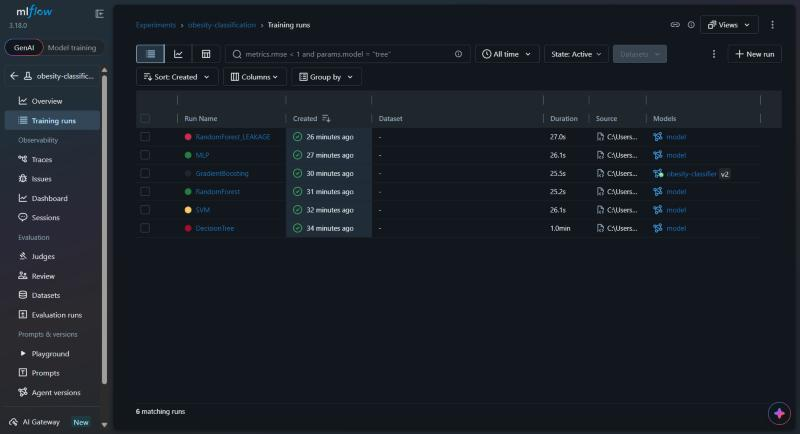
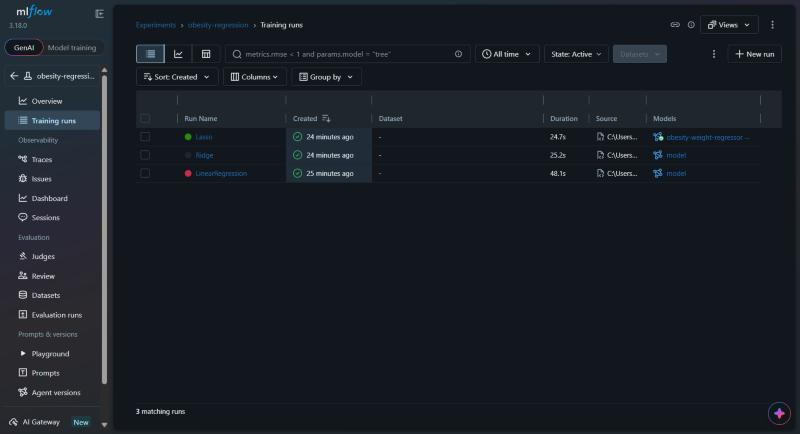
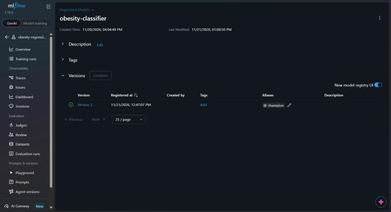

# obesity-levels

Projet Data Mining M1 : prédire le niveau d'obésité (classification multiclasse) et le poids (régression
linéaire) à partir des habitudes alimentaires et du mode de vie, avec suivi MLflow, API FastAPI, Docker et CI.

Dataset : UCI *Estimation of Obesity Levels Based on Eating Habits and Physical Condition*
(2 111 lignes, dont ~77 % synthétiques SMOTE).

## Trois pipelines, un seul split
| Pipeline | Tâche | Cible | Variables |
|---|---|---|---|
| A | Classification | `NObeyesdad` | tout sauf `Weight`, `Height` (fuite : la classe vient de l'IMC) |
| B | Régression linéaire | `Weight` | tout sauf la classe (avec `Height`) |
| C | Cohérence | classe dérivée | `IMC = poids prédit / Height²` comparé à A |

Un run de contraste « fuite » (A + `Weight` + `Height`) est tagué `leakage_reference=true` dans MLflow.

## Installation
```
python -m venv .venv && .venv\Scripts\activate
make setup
```
Sans réseau : déposer `ObesityDataSet_raw_and_data_sinthetic.csv` dans `data/raw/`.

## Commandes
| Commande | Rôle |
|---|---|
| `make data` | charge et nettoie les données |
| `make eda` | figures et tableaux d'exploration |
| `make train-clf` / `make train-reg` | GridSearchCV + runs MLflow |
| `make consistency` | pipeline C |
| `make evaluate` | tableaux comparatifs |
| `make export` | registre MLflow (alias `champion`) + `models/*.joblib` |
| `make serve` | API sur le port 8000 |
| `make mlflow-ui` | interface MLflow sur le port 5000 |
| `make test` / `make lint` | pytest / ruff |
| `make report` | génère `reports/rapport_obesity_levels.pdf` (`pip install -e ".[report]"`) |
| `make docker-build` | image Docker (lancer `make all` avant) |
| `make all` | data → entraînement → évaluation → export |

## Structure
```
config.yaml           seeds, colonnes, seuils IMC
src/obesity/          data, eda, preprocessing, train_*, consistency, evaluate, analysis, registry, api/
notebooks/            01 exploration, 02 préprocessing, 03 modélisation, 04 analyse critique
reports/              figures/ tables/ report_outline.md
docker/  tests/  docs/DECISIONS.md  .github/workflows/ci.yml
```

## Résultats (test, 30 %)
Classification (pipeline A), F1 macro sur le test : gradient boosting 0,775 (champion en CV) · RF 0,776 · SVM 0,743 · MLP 0,726 · DT 0,710 · KNN 0,685 · régression logistique 0,554 · ordinal 0,514 ; avec fuite : ~0,94 en CV.
Les quatre derniers modèles (gradient boosting, MLP, régression logistique, classifieur ordinal de Frank & Hall) ont été ajoutés après les premiers résultats : le plafond d'environ 0,78 tient aux données, pas à l'algorithme.
Régression : RMSE ≈ 18 kg, R² ≈ 0,52. Pipeline C : accuracy 0,23, ±1 classe 0,71.
Détails et limites : notebooks 03 et 04, `docs/DECISIONS.md`.

## MLflow
`make mlflow-ui` puis ouvrir http://localhost:5000 : expériences `obesity-classification` et
`obesity-regression`, modèles `obesity-classifier` et `obesity-weight-regressor` (alias `champion`).

Captures :





## API
```
curl http://localhost:8000/health

curl -X POST http://localhost:8000/predict/class -H "Content-Type: application/json" -d '{"Gender":"Female","Age":25,"family_history_with_overweight":"yes","FAVC":"yes","FCVC":2,"NCP":3,"CAEC":"Sometimes","SMOKE":"no","CH2O":2,"SCC":"no","FAF":1,"TUE":1,"CALC":"no","MTRANS":"Public_Transportation"}'

curl -X POST http://localhost:8000/predict/weight -H "Content-Type: application/json" -d '{"Gender":"Female","Age":25,"Height":1.70,"family_history_with_overweight":"yes","FAVC":"yes","FCVC":2,"NCP":3,"CAEC":"Sometimes","SMOKE":"no","CH2O":2,"SCC":"no","FAF":1,"TUE":1,"CALC":"no","MTRANS":"Public_Transportation"}'
```
`MODEL_SOURCE=registry` charge les modèles depuis le registre MLflow au lieu des fichiers joblib.

## Interface de test (Streamlit)
```
pip install -e ".[ui]"
make ui
```
Deux onglets : **Données** (téléchargement des données nettoyées, pré-traitées, train et test ; test d'un
CSV téléversé avec résultats en figures expliquées pour non-spécialistes, sans téléchargement) et
**Saisie manuelle** (guide de toutes les variables, prédiction du niveau, du poids et de l'IMC).
Nécessite `make all` au préalable.

## Docker
```
make all
docker compose -f docker/docker-compose.yml up --build
```
